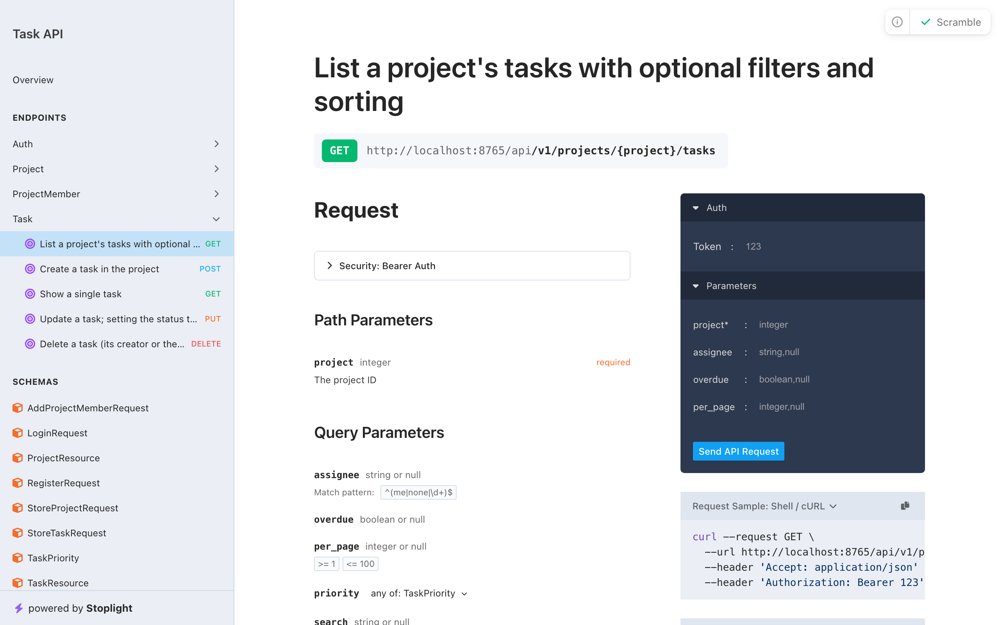
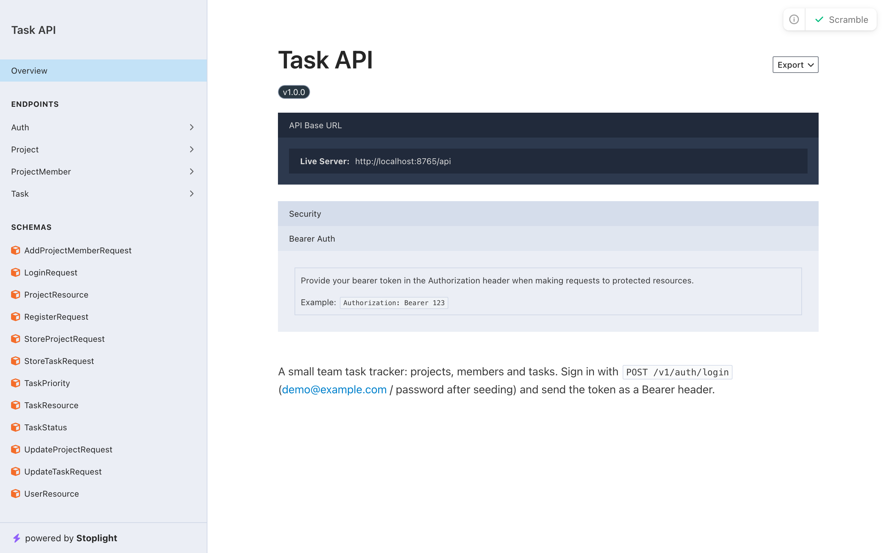
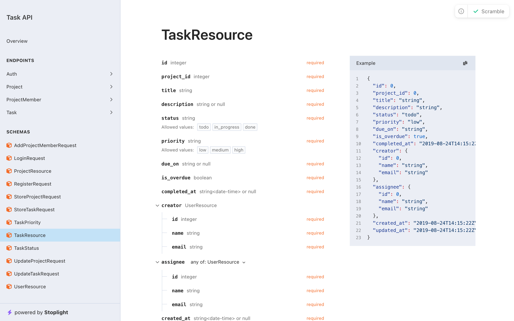

# Task API

[](https://github.com/mandlamazone-cmd/laravel-task-api/actions/workflows/tests.yml)   

A small, production-style REST API for a team task tracker, built with **Laravel 13**, **Sanctum** token auth and a full **PHPUnit** feature test suite. Users create projects, invite teammates, and track tasks with filtering, search and sorting.

There is a matching mobile app: [**task-api-mobile**](https://github.com/mandlamazone-cmd/task-api-mobile), an Expo / React Native client for this API.

It is a portfolio project: the domain is deliberately simple so the code can show how I structure a real API — versioned routes, form requests, API resources, policies, enums and tests that cover the failure cases, not just the happy path.



## Highlights

- **Token auth with Sanctum** — register, log in (rate limited to 5 attempts/minute per email + IP), log out of the current device only.
- **Versioned API** under `/api/v1`, every response shaped by an Eloquent API Resource.
- **Authorization in policies**, with non-members getting `404` rather than `403` so project and task ids never leak to outsiders.
- **Nested, scoped routes** — `/projects/{project}/tasks/{task}` returns `404` if the task belongs to a different project.
- **Filtering, search and sorting** validated by a form request: whitelisted sort keys (no SQL injection through `?sort=`), `LIKE` wildcards in search treated literally, priority sorted by weight rather than alphabetically, undated tasks sorted last.
- **Small domain rules kept close to the model** — `completed_at` follows the task status; removing a member unassigns their tasks in that project only.
- **Auto-generated OpenAPI docs** with [Scramble](https://scramble.dedoc.co), read straight from the form requests and resources.
- **78 feature tests**, Pint code style and GitHub Actions CI on PHP 8.4 and 8.5.

## Stack

| | |
| --- | --- |
| Language | PHP 8.4+ |
| Framework | Laravel 13 |
| Auth | Laravel Sanctum (personal access tokens) |
| Database | SQLite by default; MySQL or PostgreSQL work unchanged |
| Tests | PHPUnit 12, in-memory SQLite |
| Docs | Scramble (OpenAPI 3.1) |
| CI | GitHub Actions — Pint + PHPUnit matrix |

## Running it locally

Requirements: PHP 8.4+ with `pdo_sqlite`, and Composer.

```bash
git clone https://github.com/mandlamazone-cmd/laravel-task-api.git && cd laravel-task-api
composer install
cp .env.example .env
php artisan key:generate
touch database/database.sqlite
php artisan migrate --seed
php artisan serve
```

The seeder creates a demo account — **demo@example.com / password** — with two projects and twenty tasks.

Interactive API docs are then at <http://localhost:8000/docs/api> (shown in the local environment only).

### Running the tests

```bash
php artisan test
```

```bash
vendor/bin/pint --test
```

## Using the API

Get a token:

```bash
curl -X POST http://localhost:8000/api/v1/auth/login \
  -H "Accept: application/json" \
  -d email=demo@example.com -d password=password -d device_name=cli
```

Then send it as a bearer token. For example, the highest-priority overdue tasks in a project:

```bash
curl "http://localhost:8000/api/v1/projects/1/tasks?overdue=1&sort=-priority" \
  -H "Accept: application/json" \
  -H "Authorization: Bearer <token>"
```

```json
{
  "data": [
    {
      "id": 11,
      "project_id": 1,
      "title": "Fix login timeout on slow networks",
      "description": null,
      "status": "todo",
      "priority": "high",
      "due_on": "2026-10-27",
      "is_overdue": true,
      "completed_at": null,
      "creator": { "id": 1, "name": "Demo User", "email": "demo@example.com" },
      "assignee": null,
      "created_at": "2026-10-30T23:32:42.000000Z",
      "updated_at": "2026-10-30T23:32:42.000000Z"
    }
  ],
  "links": { "...": "..." },
  "meta": { "current_page": 1, "per_page": 20, "total": 3, "...": "..." }
}
```

### Endpoints

| Method | Path | Notes |
| --- | --- | --- |
| `POST` | `/api/v1/auth/register` | Returns a token, `201` |
| `POST` | `/api/v1/auth/login` | Rate limited |
| `POST` | `/api/v1/auth/logout` | Revokes the current token only |
| `GET` | `/api/v1/me` | The signed-in user |
| `GET` `POST` | `/api/v1/projects` | Projects you belong to / create one |
| `GET` `PATCH` `DELETE` | `/api/v1/projects/{project}` | Update and delete are owner only |
| `GET` `POST` | `/api/v1/projects/{project}/members` | Add a member by email (owner only) |
| `DELETE` | `/api/v1/projects/{project}/members/{user}` | Unassigns their tasks in the project |
| `GET` `POST` | `/api/v1/projects/{project}/tasks` | Filters below |
| `GET` `PATCH` `DELETE` | `/api/v1/projects/{project}/tasks/{task}` | Delete: creator or project owner |

Task list query parameters:

| Parameter | Values |
| --- | --- |
| `status` | `todo`, `in_progress`, `done` |
| `priority` | `low`, `medium`, `high` |
| `assignee` | `me`, `none`, or a user id |
| `overdue` | `1` — open tasks past their due date |
| `search` | Text in the title |
| `sort` | `created_at`, `due_on`, `priority`, `title`; prefix `-` for descending (default `-created_at`) |
| `per_page` | 1–100 (default 20) |

## Project layout

```
app/
├── Enums/                      TaskStatus, TaskPriority
├── Http/
│   ├── Controllers/Api/V1/     Auth, Project, ProjectMember, Task
│   ├── Requests/Api/V1/        Validation for every write and for list filters
│   └── Resources/V1/           JSON shape of every response
├── Models/                     User, Project, Task
└── Policies/                   ProjectPolicy, TaskPolicy
tests/Feature/
├── Http/Controllers/Api/V1/    One test class per controller
├── Models/                     Task status and overdue rules
└── Policies/                   Full permission matrix per policy
```

## Design notes

- **404 for outsiders, 403 for members.** A member who lacks a permission learns why (`403` with a message); someone outside the project cannot tell whether it exists.
- **Policies are tested directly** as a permission matrix, and each endpoint has one HTTP test showing it actually calls the policy.
- **Mass assignment is covered by tests**: sending `owner_id`, `creator_id`, `project_id` or `email_verified_at` in a payload has no effect.
- **No N+1 queries** on list endpoints — relations are eager loaded and counts use `withCount`.

## More screenshots

| Overview | Task schema |
| --- | --- |
|  |  |

## Licence

MIT — see [LICENSE](LICENSE).
